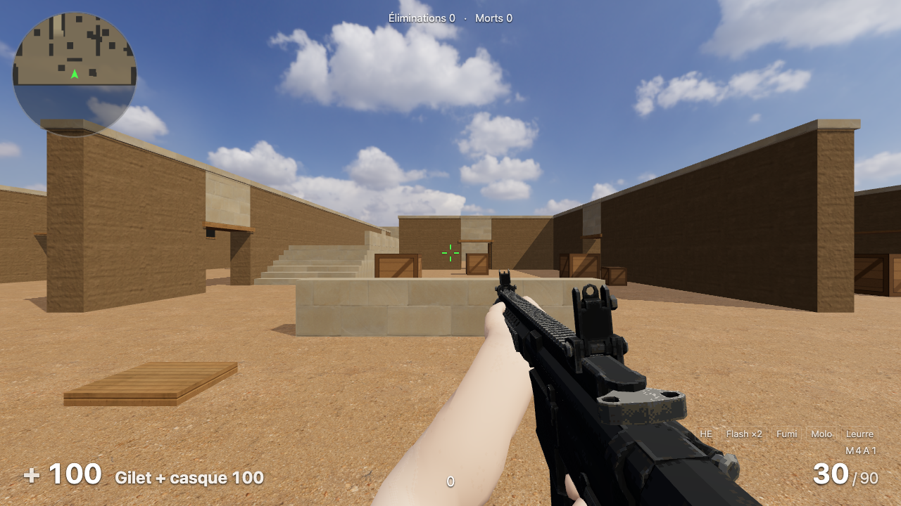
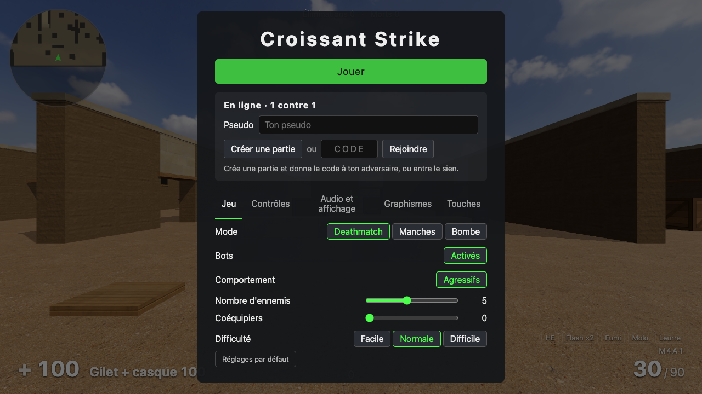

# Croissant Strike 🥐

Jeu de tir à la première personne, inspiré de Counter-Strike: Source : bots, manches avec économie,
cinq grenades et 1 contre 1 en ligne, directement dans le navigateur.

Projet commencé par [Leochartrain](https://github.com/Leochartrain) sous le nom **FPS1**, dans son dépôt
[projets](https://github.com/Leochartrain/projets) ; l'historique de ses commits est conservé ici.

<p align="center">
  
  
</p>
Fait avec [Three.js](https://threejs.org), TypeScript et [Vite](https://vite.dev).

## Lancer

Il faut [Node.js](https://nodejs.org) 20 ou plus.

```sh
npm install     # une seule fois
npm run dev     # puis ouvrir http://localhost:5173
```

`npm run build` produit une version finale dans `dist/`.

### Armes et bras animés

Les armes et les bras animés viennent du pack **PSX-Weapons Assets** (`RetroWeaponPack_V1.zip`) de
[Kuptchi](https://kuptchi.itch.io/f), gratuit et utilisable librement, y compris commercialement
(seule la revente du pack est interdite). Les fichiers utilisés par le jeu (~4 Mo) sont dans
`public/assets/weapons/`.

Pour les regénérer (après une mise à jour du pack, par exemple) :

1. Télécharger `RetroWeaponPack_V1.zip` (482 Mo) et le poser à la racine du projet.
2. Lancer `npm run import-weapons`.

Le script extrait du zip uniquement ce qui sert et compresse les animations. Sans ces fichiers, le jeu
affiche des armes en blocs.

## En ligne (GitHub Pages)

Le jeu est publié sur **https://pchartie.github.io/croissant-strike/** à chaque push sur `main`, par une
GitHub Action (`.github/workflows/pages.yml`) qui le compile avec `VITE_BASE=/croissant-strike/`.

## Faire tester à distance (tunnel Cloudflare)

Sans compte ni nom de domaine, avec [cloudflared](https://github.com/cloudflare/cloudflared/releases) (ici dans `D:Tools`) :

```sh
npm run build                 # version compilée, plus rapide à travers le tunnel
npx vite preview --port 4173  # sert le dossier dist/
cloudflared tunnel --url http://localhost:4173
```

`cloudflared` affiche une adresse `https://….trycloudflare.com` à envoyer. Elle change à chaque lancement et ne marche que tant que les deux commandes tournent. `vite.config.ts` autorise ces adresses.

## Commandes (par défaut, modifiables dans les réglages)

| Touche | Action |
|---|---|
| Z Q S D | Se déplacer (W A S D en QWERTY) |
| Souris | Viser (axe vertical inversé par défaut, réglable) |
| Clic gauche | Tirer |
| R | Recharger |
| 1 / 2 / 3 | Arme principale (M4A1, MP5-SD ou Nova) / pistolet (M1911) / couteau |
| B | Menu d'achat (puis 1 à 0 pour acheter) |
| Tab | Tableau des scores (maintenir) |
| Clic gauche / droit | Avec le couteau : coup rapide / coup puissant |
| 4 | Grenades (appuyer à nouveau pour passer à la suivante) |
| Clic gauche / droit / les deux | Avec une grenade : lancer loin / en cloche / à mi-distance |
| Espace / molette | Sauter |
| Ctrl ou C | S'accroupir (plus lent, plus précis ; sauter accroupi permet de monter sur les grosses caisses) |
| Maj | Marcher lentement |
| Échap | Ouvrir ou fermer le menu (menu fermé : un clic relance la partie) |

## Structure

```
src/
├── main.ts        point d'entrée
├── config.ts      constantes de jeu (vitesses, gravité, sensibilité, difficulté des bots…)
├── core/          boucle de jeu (physique à 128 ticks/s), clavier et souris, sons
├── world/         chargement de la carte, collisions (avec marches), grille de navigation des bots, ensoleillement
├── maps/          données des cartes produites par Blender (collisions, objets)
├── player/        déplacements façon CS: Source et caméra
├── weapons/       caractéristiques des armes, tir et recul, arme en main, impacts
├── grenades/      les 5 grenades : lancer, rebonds, explosion, flash, fumée, feu, leurre
├── net/           jeu en ligne : connexion PeerJS, messages, adversaire affiché
├── bots/          ennemis et coéquipiers : soldats animés, IA (patrouille, combat, recherche), apparitions
└── ui/            HUD, fil des éliminations, écrans de pause et de mort
```

Le réticule est fixe, mais les balles se dispersent quand on court, saute ou tire en rafale : comme dans CS, il faut s'arrêter pour être précis.

## Performances

Priorité absolue : le jeu doit rester fluide sur un petit PC. `npm run bench -- <nom> [dunes|medina]` (avec `npm run dev` lancé à côté) ouvre le jeu dans Brave (ou `BROWSER=…`), se place à six endroits fixes de la carte et mesure le temps par image, les appels de dessin et les triangles, avec une capture de chaque point (dans `bench/`). À lancer avant et après chaque changement qui touche au rendu.

Repère (MacBook Pro 2018, Intel UHD 630, 1280 × 720, 5 bots) : 29 ms par image avec les ombres en temps réel, 15 ms avec l'éclairage précalculé.

## Interface

**Tab** (maintenu) : tableau des scores, avec éliminations, morts, headshots et précision. **Radar** en haut à gauche : la carte tourne avec le regard, et les ennemis apparaissent en rouge quand on les voit (ils s'effacent 1,5 s après). En fin de match (mode manches) : bilan avec éliminations, morts, précision, headshots et dégâts.

## Réglages

Le menu (Échap) range les réglages en rubriques à gauche, avec leurs options à droite et **Jouer** toujours en bas. Les réglages sont mémorisés dans le navigateur :

- **Partie** : carte (choisie sur de grandes vignettes avec une capture ; Dunes, la carte grise, par défaut, ou Médina ; en changer recharge la page), mode, bots activés ou non, passifs (par défaut) ou agressifs, nombre d'ennemis (1 à 10), coéquipiers (0 à 4) et difficulté (facile, normale, difficile).
- **Contrôles** : sensibilité de la souris (même échelle que CS), axe vertical inversé ou non, champ de vision.
- **Audio et affichage** : volume, couleur et taille du réticule.
- **Graphismes** : résolution de rendu (50 à 100 %, pour les PC moins puissants), compteur d'images par seconde (affiché par défaut, sous le radar). Plus de réglage des ombres : celles de la carte sont précalculées (voir Carte).
- **Touches** : toutes les touches se changent (deux par action, clavier ou souris, molette comprise) : on clique sur une case puis on appuie sur la touche voulue. Les lettres s'affichent selon ton clavier (Z, Q, S, D en AZERTY).

Les réglages sont décrits dans `src/core/settings.ts` : le panneau est construit à partir de cette liste, donc ajouter un réglage se fait en quelques lignes. Les préréglages de difficulté sont dans `src/config.ts` (`DIFFICULTY`).

## Armes et équipement

Armes principales (touche 1, une seule à la fois) : **M4A1**, **MP5-SD** (SMG silencieux, précis en mouvement) et **Nova** (fusil à pompe, 9 plombs, rechargé cartouche par cartouche). Les dégâts baissent avec la distance comme dans CS. **Gilet** et **casque** : le gilet réduit les dégâts au corps et aux explosions selon l'arme, le casque protège la tête, rien ne protège les jambes ni le feu. Les bots portent gilet et casque.

À chaque tir, la **douille** est éjectée à droite de l'arme (5,56 pour la M4A1, 9 mm pour la MP5 et le pistolet, cartouche rouge au coup de pompe de la Nova) : elle rebondit en tintant et reste 10 s au sol. Les douilles des bots aussi, quand ils tirent près de toi.

Les armes à feu sont représentées par leur **silhouette** dans le fil des éliminations (avec « tête » pour un headshot), au-dessus des munitions et dans le menu d'achat ; le couteau et les grenades gardent leur nom.

## Couteau

Comme dans CS:GO (touche 3) : clic gauche rapide (40, puis 25 en enchaînant, 90 dans le dos, portée 1,2 m), clic droit puissant (65, 180 dans le dos, portée au contact). On le tient de la main droite, avec les mêmes bras que pour les armes à feu ; les coups sont animés par le code (balayage, coup de pointe).

## Modes de jeu

À choisir dans les réglages :

- **Deathmatch** : on réapparaît 3 s après chaque mort (avec gilet, casque et grenades), les bots aussi. Le menu d'achat (B) est gratuit : on y choisit son arme principale.
- **Manches** : comme dans CS, une vie par manche, avec l'économie de CS:GO (800 $ au départ, primes d'élimination selon l'arme, 3 250 $ par manche gagnée, bonus de défaite de 1 400 à 3 400 $). On achète avec B pendant le gel et les 20 premières secondes (le menu se ferme dès qu'on achète une arme ; il reste ouvert pour enchaîner grenades et protections) ; en survivant on garde son équipement, en mourant il ne reste que le pistolet. Tu pars du sud, les bots du nord. 3 s de gel au départ, 1:55 de chrono ; on gagne la manche en éliminant l'autre camp, et les bots la gagnent si le temps s'écoule. Le premier à 5 manches remporte le match. Réglages dans `src/config.ts`, section `ROUNDS`.

## En ligne (1 contre 1)

Dans le menu (Échap), rubrique **En ligne** : choisis un pseudo (il sert aussi en solo, dans le fil des éliminations et le tableau des scores), puis **Créer une partie** pour recevoir un code de 4 caractères à donner à ton adversaire ; lui l'entre et clique sur **Rejoindre**. C'est un deathmatch à deux (réapparition 3 s après chaque mort, hors de vue de l'autre), sans bots pour l'instant ; armes, gilet, couteau (coups dans le dos compris) et les cinq grenades marchent comme contre les bots. Une grenade vole chez les deux joueurs, et celui qui la lance annonce où elle éclate : HE, flash, fumée et feu sont donc au même endroit sur les deux écrans. **Quitter la partie** (ou le départ de l'autre) ramène au jeu seul, avec tes réglages. Les deux joueurs doivent être sur la même carte : sinon, la connexion s'arrête en indiquant celle de l'autre.

La connexion est directe entre les deux navigateurs (WebRTC, avec [PeerJS](https://peerjs.com)) : le serveur public de PeerJS sert seulement à se trouver grâce au code. Ça marche en local comme sur GitHub Pages, chacun chez soi. Sur certains réseaux très fermés (entreprise, certaines box), la connexion directe peut échouer. Chacun fait foi pour ses propres tirs (« je t'ai touché à la tête ») et l'autre applique les dégâts avec son gilet ; l'adversaire est affiché avec 100 ms de retard pour un mouvement fluide. Pour tester seul, ouvre le jeu dans deux fenêtres.

## Grenades

Les cinq grenades de CS:GO, avec ses valeurs (vitesse de lancer, gravité, rebonds) : **HE** (jusqu'à 98 de dégâts, arrêtée par les murs), **flash** (aveugle selon l'angle et la distance, toi comme les bots), **fumigène** (18 s, cache la vue des bots et éteint les molotovs), **molotov** (feu de 7 s, 40 dégâts par seconde) et **leurre** (imite des tirs de fusil pendant 15 s et attire les bots). On en reçoit une de chaque, plus une deuxième flash, à chaque manche ou réapparition. Les bots lancent aussi des HE et des flashs (voir Bots).

## Cartes

Deux cartes, au choix dans **Partie → Carte** (`src/world/maps.ts` : limites, apparition du joueur, zones de départ en mode manches). Les marches de moins de 46 cm se montent sans sauter, comme dans CS, y compris quand elles sont faites de plusieurs blocs empilés (une dalle sur son socle).

**Médina** : vieille ville du Maghreb de 80 × 92 m, façon de_dust2. Spawn T au sud (le joueur), spawn CT au nord. Trois voies : à l'ouest la **Longue** (rue droite de 50 m fermée par les Portes longues, avec un Coin), au centre le **Milieu** (sous une arche, puis une place avec un puits et les **Portes CT**) d'où la **Passerelle** surélevée mène à A, à l'est le **Souk** couvert de bandes de toile. **Site A** : terrasse surélevée de 1,2 m avec un Plateau ; **site B** : cour avec une fontaine, reliée au Milieu par la **Ruelle** et les Portes B. Trajets : 6 à 9 s pour les CT jusqu'aux sites, 16 à 22 s pour les T, la place du Milieu à égalité. Tout est décrit dans `map/medina/build.py` : une centaine de maisons en crépi de quatre teintes (soubassement, corniche, fenêtres à volets bleus ou verts, portes), rues pavées, places en sable tassé, terrasse A dallée, cour B dallée de pierre beige avec une fontaine en zellige animée par le jeu (jet et gouttes, rideau d'eau qui déborde de la vasque, reflets qui ondulent, écume : `src/world/fountain.ts`), puits sur la place du Milieu (socle, frise de zellige, margelle, treuil avec corde et seau, petit toit de tuiles vertes), arche en grès, toiles colorées au-dessus du souk, minaret au nord (repère visible de partout) et neuf palmiers touffus (deux étages de palmes) modélisés par le script (`map/lib/palm.py`).

Pour la vie des rues : des objets Poly Haven (voiture bâchée en B et au spawn CT, climatiseurs sur les façades, jarres, cruches et plantes en pot, poubelles, café sur la place du Milieu (cinq tables, dont trois autour du puits, chaises en plastique et lanternes), étals garnis dans le souk), des détails plaqués sur les murs (saleté au pied des murs, coulures sous les corniches, fissures, affiches déchirées : images dessinées par `map/lib/decals.py`) et des câbles électriques qui pendent d'une façade à l'autre au-dessus des rues. La construction signale les objets qui se chevauchent (`map/lib/props.py`).

**Dunes (grise)**, une petite carte « squelette » de 72 × 72 m, façon de_dust : apparition au sud, trois voies vers le nord — la longue voie à l'ouest jusqu'à une plateforme surélevée, le milieu avec sa passerelle et ses portes, le couloir à l'est jusqu'à une seconde plateforme. Sans textures ni objets : quadrillage de 1 m et une couleur par rôle (murs, sol, surélevé, obstacles, linteaux).

Textures de [Poly Haven](https://polyhaven.com) en CC0, couleur seulement, à leur taille réelle (`public/textures/`, téléchargées et converties en WebP par `npm run fetch-textures`).

**Objets** de [Poly Haven](https://polyhaven.com) (CC0, crédits dans `public/assets/props/CREDITS.md`), optimisés pour le navigateur par `npm run optimize-props` (maillages simplifiés, textures WebP de 256 à 512 px, géométrie compressée Meshopt) : chaque modèle est dessiné en un seul appel pour tous ses exemplaires (instanciation). Le verre qui réfracte (lanterne) devient une simple transparence : sinon three.js redessinerait toute la scène une seconde fois à chaque image. Chaque modèle est mis à l'échelle d'après ses sommets, pas d'après les boîtes de ses morceaux (celle d'un morceau tourné est trop grande : l'objet serait réduit et flotterait).

### Éclairage précalculé (Blender)

La carte est construite par [Blender](https://www.blender.org) (4.5 ou plus), qui calcule aussi son éclairage une fois pour toutes, comme dans CS : ombres douces du soleil, lumière du ciel et rebonds (le sable éclaire le pied des murs à l'ombre). Le jeu n'a donc plus d'ombres à calculer à chaque image, et les surfaces de la carte se dessinent sans calcul de lumière (couleur de la texture × éclairage) : c'est à la fois plus beau et beaucoup plus rapide.

```sh
npm run build-map -- medina           # qualité finale : 2048 px, 256 échantillons (~10 min)
npm run build-map -- medina 512 16    # essai rapide (quelques secondes)
```

- `map/lib/kit.py` construit le maillage à partir de blocs (et d'outils : escaliers, bâtiments qui remplissent tout ce qui n'est pas une rue, sans toits puisqu'on ne les voit jamais) : faces cachées retirées (contre un autre bloc, sous le sol, hors de la carte), textures alignées sur le monde (elles continuent d'un bloc à l'autre), un seul maillage avec un matériau par matière.
- `map/lib/bake.py` range les faces dans la carte d'éclairage (même densité partout, ~12 pixels par mètre en 2048 sur Médina), règle le soleil et le ciel HDR comme dans le jeu, lance le calcul (Cycles) et exporte.
- `map/<carte>/build.py` décrit chaque carte : Médina à partir des zones jouables de son plan, Dunes à partir des blocs de l'ancienne version (`map/dunes/layout.json`).
- Résultat : `public/maps/<carte>/` (maillage .glb compressé, ~50 Ko ; éclairage .webp) et `src/maps/<carte>.json` (collisions en boîtes, objets posés), inclus dans le code du jeu. Les fichiers produits sont versionnés : GitHub Pages n'a pas besoin de Blender.

Ce qui bouge n'a plus d'ombre calculée : les bots ont une ombre ronde au sol, et eux comme les objets posés s'assombrissent à l'ombre des murs (un rayon vers le soleil à travers les collisions, `src/world/sunlight.ts`).

## Ambiance

Rendu des couleurs Khronos PBR Neutral (fidèle et franc, un peu moins exposé que la normale), brume de chaleur légère qui adoucit les lointains (couleur de l'horizon tirée vers le sable) et bords de l'image légèrement assombris (un dégradé en CSS par-dessus l'image). Rien de tout ça ne coûte de passe de rendu en plus.

## Ciel

Ciel HDR de [Poly Haven](https://polyhaven.com) en CC0 (`public/sky/`) : il sert de fond et d'éclairage ambiant, et le soleil du jeu est placé là où il apparaît dans le ciel, pour que les ombres soient cohérentes.

## Sons

**Pas** : on entend ses pas et ceux des bots (situés à gauche ou à droite), avec un bruit différent sur le sable, la pierre, le bois ou le métal ; silence en marchant (Maj) ou accroupi, comme dans CS. Les bots entendent les pas du joueur qui court à moins de 15 m et viennent voir. Les balles font aussi un bruit et des éclats selon la matière touchée (étincelles sur le métal, éclats de bois, gerbe de sable). Touché, on est ralenti un instant et la visée sursaute, comme dans CS:GO.

Vrais enregistrements d'armes (AR-15 et 1911) et de rechargements, en CC0 : voir `public/sounds/CREDITS.md`. Les tirs des bots utilisent une prise de son lointaine et viennent de gauche ou de droite selon leur position, pour les repérer à l'oreille. Si les fichiers manquent, le jeu revient aux sons synthétisés.

## Bots

Les bots patrouillent sur toute la carte (escaliers et plateformes compris), t'attaquent dès qu'ils te voient et vont voir quand ils t'entendent tirer ou courir. Ils tirent en rafales en s'arrêtant, puis se décalent sur le côté entre deux rafales (en sautant parfois). Chacun a une HE et une flash par vie : quand tu te caches, il peut lancer une flash avant d'aller te chercher, ou une HE sur ta cachette (lancer en cloche calculé pour exploser sur place). Une balle dans la tête fait ×4 de dégâts, dans les jambes ×0,75, pour eux comme pour toi.

**Soldats** : le mannequin CC0 de l'[Universal Animation Library](https://quaternius.com/packs/universalanimationlibrary.html) de Quaternius, habillé par `characters/build.py` (`npm run build-characters`, avec Blender) : corps coloré selon l'os qui porte chaque partie (peau, chemise, gants, pantalon, bottes), gilet à poches et ceinture, cagoule pour tous (le mannequin n'a pas de visage), casque et lunettes pour les CT. Deux tenues sur le même squelette : les ennemis en CT (bleu marine, casque), les coéquipiers en T (kaki, cagoule). Grain de tissu sur les tenues (sergé, toile épaisse pour les gilets, cuir pour les gants et les bottes), projeté selon les trois axes sur la pose de repos par un ajout au shader : le motif suit le corps sans coordonnées de texture. Un seul maillage animé par soldat (un appel de dessin), environ 7 700 triangles, 510 Ko pour les deux tenues et leurs animations, 20 Ko pour les tissus.

Animations mélangées en deux moitiés (`src/bots/BotModel.ts`) : le bas du corps marche, court ou s'accroupit selon la vitesse ; le haut vise et suit le regard en combat, arme basse sinon, avec par-dessus le tir et le rechargement ; mort animée. Le pack gratuit n'ayant pas d'animations au fusil, le fusil est épaulé par le code (crosse contre l'épaule droite, pointé où regarde le bot) et les mains y sont posées par IK à deux os : la droite sur la poignée, la gauche sur le garde-main (sauf au rechargement, où elle va chercher le chargeur). Les poses de visée du pack penchent le dos : il est redressé, et le bassin rebondit moins dans la course. Les zones de touche restent des boîtes fixes (tête, corps, bras tendus, jambes), comme dans CS.

**Coéquipiers** : jusqu'à 4 bots dans ton camp (réglage « Coéquipiers », 0 par défaut), en tenue bleu-gris. Ils combattent les ennemis avec la même IA, s'entendent tirer entre camps, et apparaissent groupés autour de toi en mode manches ; la manche continue tant qu'un membre de ton équipe est en vie. Pas de tir ami : tes balles les traversent, tes grenades et ton feu ne les blessent pas, et inversement. Ils sont toujours visibles sur le radar (en bleu) et ont leur ligne dans le tableau des scores.

En mode **passif** (le réglage par défaut ; « Agressifs » dans les réglages pour qu'ils attaquent), ils se promènent sans attaquer ni réagir aux tirs : pratique pour s'entraîner à viser.

Le nombre de bots et la difficulté se choisissent dans les réglages ; le détail de chaque niveau (temps de réaction, précision, chance de viser la tête…) est dans `src/config.ts`, section `DIFFICULTY`.
