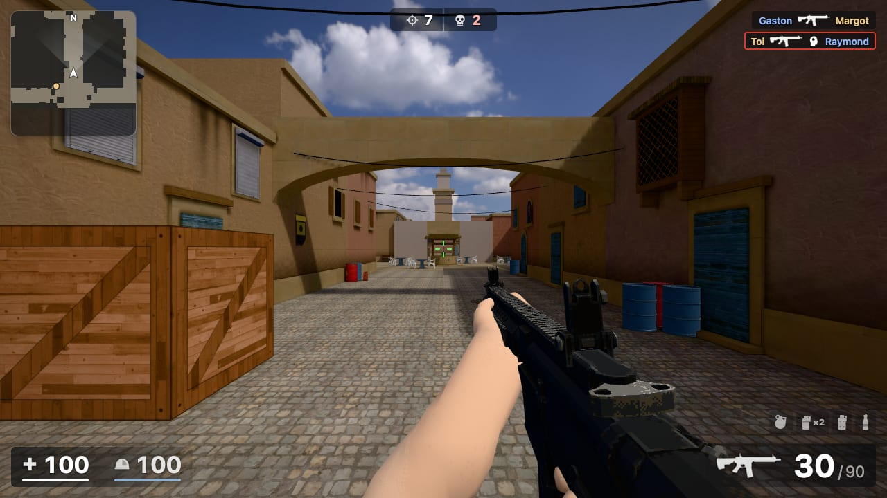
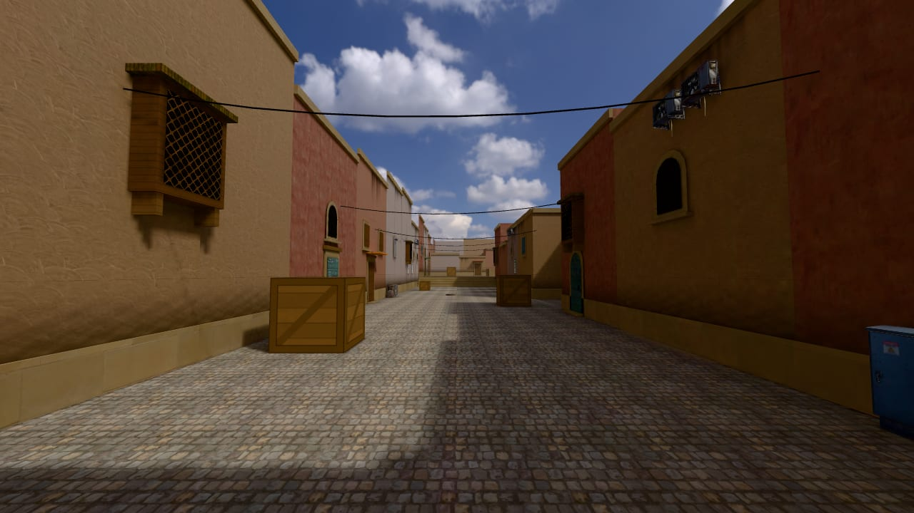
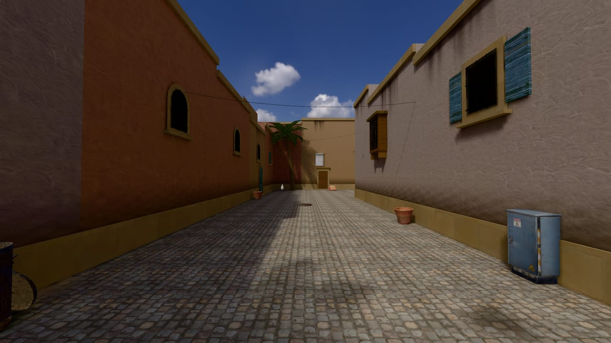
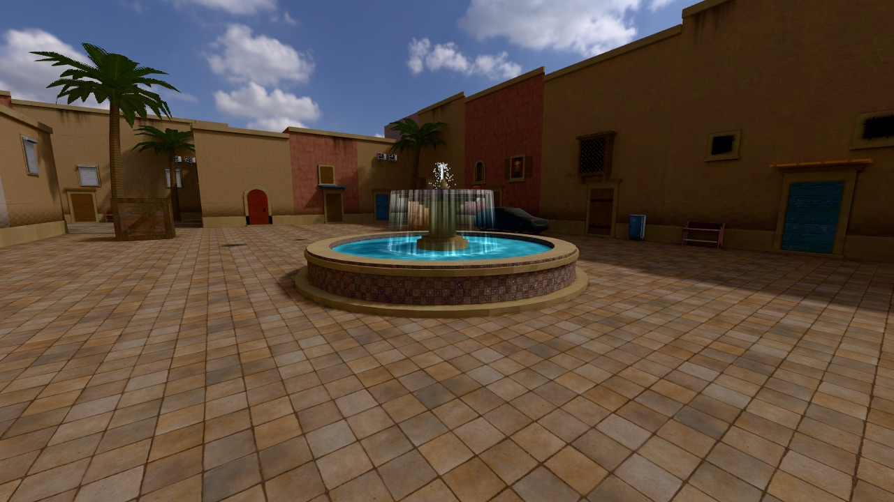
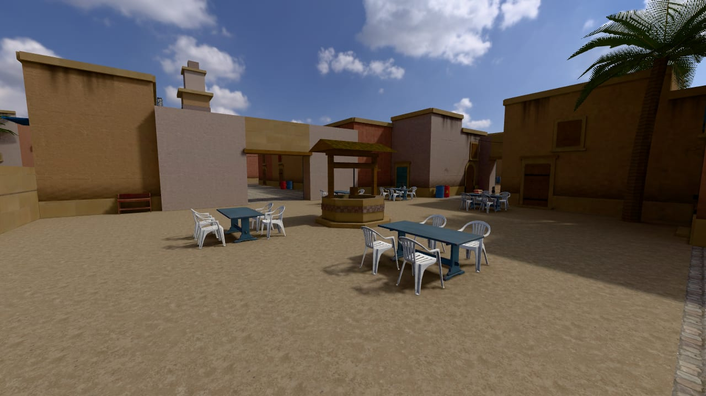
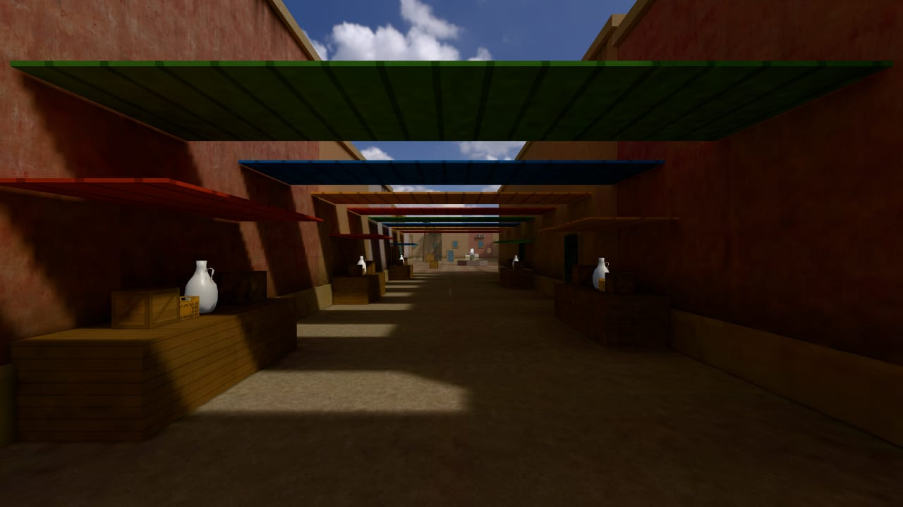
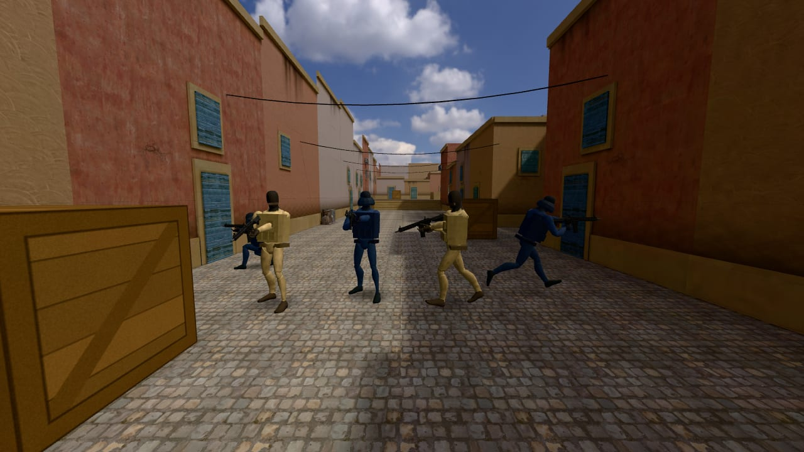
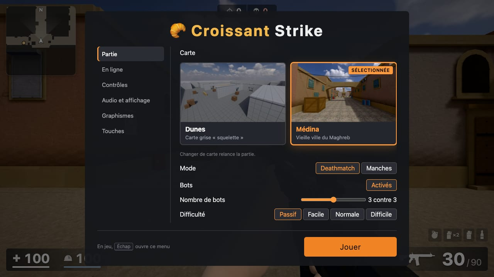
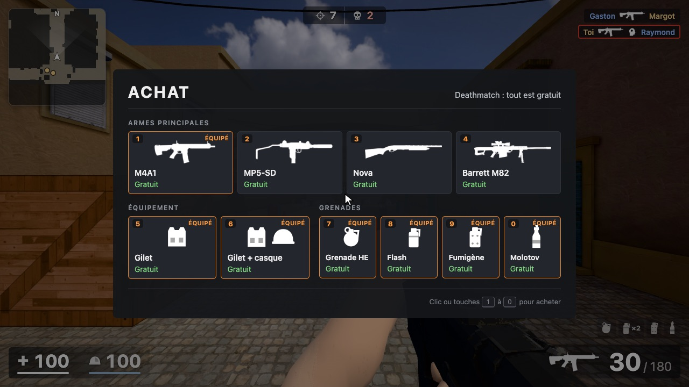
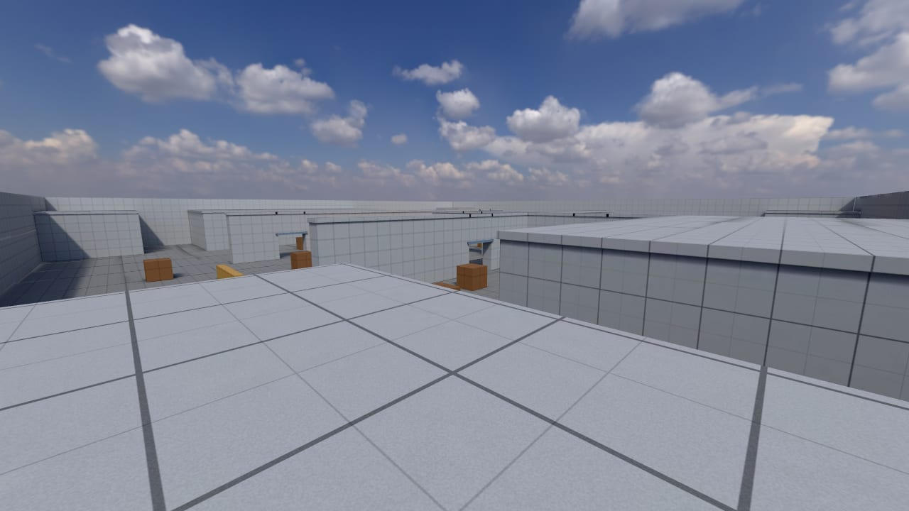

# Croissant Strike 🥐

FPS façon Counter-Strike, directement dans le navigateur : bots, manches avec économie, grenades et 1 contre 1 en ligne.

**▶ Jouer : https://pchartie.github.io/croissant-strike/**

<p align="center">
  
</p>

<p align="center">
  
  
  
  
  
  
  
  
</p>

## Au programme

- **2 cartes** : *Médina*, vieille ville du Maghreb façon de_dust2 (éclairage précalculé dans Blender ; fenêtres, portes et boutiques variées, moucharabiehs, fontaine animée, puits, souk, jarres et pots qui se cassent sous les balles), et *Dunes*, une carte grise pour s'entraîner.
- **Armes** : M4A1, MP5-SD, Nova, sniper Barrett M82 (lunette à deux crans au clic droit, valeurs de l'AWP), pistolet M1911 et couteau (coups dans le dos compris), avec dégâts, recul et dispersion de CS.
- **4 grenades** : HE, flash, fumigène et molotov.
- **Bots** : soldats animés, équipes de même taille comme dans CS, de 1 contre 1 à 5 contre 5 (toi compris), passifs (par défaut, pour s'entraîner à viser) ou en 3 difficultés ; tir allié activé ; touche P pour les figer et les inspecter.
- **Modes** : deathmatch (chaque camp réapparaît dans sa base) ou manches avec l'économie de CS:GO.
- **1 contre 1 en ligne** : on crée une partie, on envoie le code de 4 caractères à son adversaire.
- **HUD façon CS2** : radar, fil des éliminations, vie et gilet, menu d'achat illustré.

## Commandes

| Touche | Action |
|---|---|
| Z Q S D | Se déplacer |
| Clic gauche / R | Tirer / recharger |
| Clic droit | Lunette du sniper |
| 1 · 2 · 3 · 4 | Arme principale · pistolet · couteau · grenades |
| Molette | Arme suivante / précédente |
| B | Menu d'achat |
| Espace · C · Maj | Sauter · s'accroupir · marcher |
| Tab | Scores |
| P | Figer les bots (pour les inspecter) |
| Échap | Menu et réglages |

Les touches suivent ton clavier (Z Q S D en AZERTY, W A S D en QWERTY) et se changent toutes dans le menu (**Touches**).

## Lancer en local

Il faut [Node.js](https://nodejs.org) 20 ou plus.

```sh
npm install
npm run dev     # puis http://localhost:5173
```

Chaque push sur `main` met à jour le site (GitHub Pages).

## Pour aller plus loin

| Commande | Rôle |
|---|---|
| `npm run build-map -- medina` | Construit une carte et précalcule son éclairage (Blender 4.5) |
| `npm run build-characters` | Habille et anime les soldats (Blender) |
| `npm run fetch-textures` | Télécharge les textures Poly Haven |
| `npm run import-weapons` | Importe les armes depuis `RetroWeaponPack_V1.zip` |
| `npm run import-sniper` | Importe le sniper depuis `Barret.fbx` |
| `npm run bench -- <nom> [dunes\|medina]` | Mesure les performances (la priorité du projet) |

```
src/      le jeu (core, world, player, weapons, grenades, bots, net, ui)
map/      les cartes, décrites en Python pour Blender
characters/  les soldats
public/   modèles, textures, sons, ciel
```

<p align="center">
  
</p>

## Crédits

- Projet commencé par [Leochartrain](https://github.com/Leochartrain) sous le nom FPS1 ([dépôt d'origine](https://github.com/Leochartrain/projets)).
- Armes et bras : *PSX-Weapons Assets* de [Kuptchi](https://kuptchi.itch.io/f).
- Sniper : *PSX Style Sniper Rifle Pack* de [bigjigglydev](https://bigjigglydev.itch.io/psx-style-sniper-rifle-pack).
- Soldats : *Universal Animation Library* de [Quaternius](https://quaternius.com) (CC0).
- Textures, objets et ciel : [Poly Haven](https://polyhaven.com) (CC0).
- Sons : voir `public/sounds/CREDITS.md`.
- Fait avec [Three.js](https://threejs.org), TypeScript, [Vite](https://vite.dev), [Blender](https://www.blender.org) et [PeerJS](https://peerjs.com).
